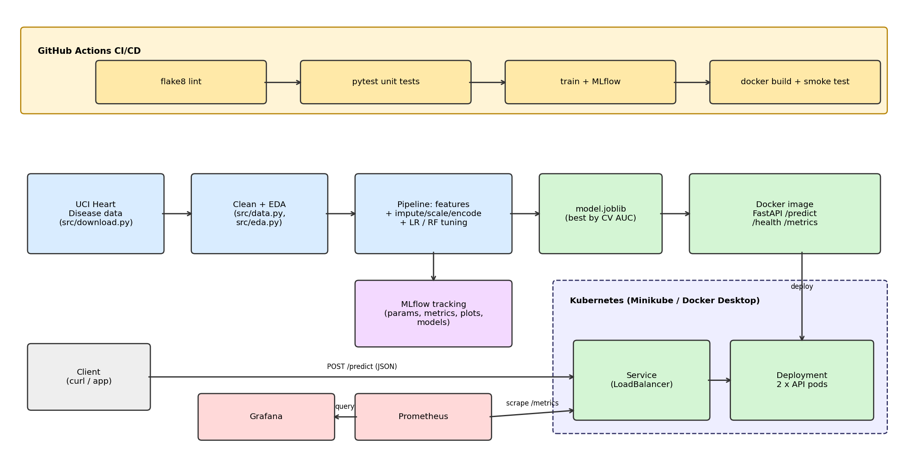

# Heart Disease Risk - End-to-End MLOps Project

Predicts heart-disease risk from patient health data (UCI Cleveland dataset) and serves it
as a containerised, monitored FastAPI service on Kubernetes, with CI/CD on GitHub Actions.



## Repository layout
| Path | Purpose |
|---|---|
| `src/download.py`, `src/data.py` | Download UCI data, clean it, write `data/processed/heart_clean.csv` |
| `src/eda.py` | EDA figures -> `reports/figures/` |
| `src/features.py` | Feature engineering + preprocessing as one sklearn `Pipeline` |
| `src/train.py` | Grid-search + CV for Logistic Regression & Random Forest, MLflow tracking, saves best model |
| `app/main.py` | FastAPI service (`/predict`, `/health`, `/metrics`) |
| `tests/` | pytest unit tests (data, features, model, API) |
| `Dockerfile`, `requirements*.txt` | Container + pinned dependencies |
| `k8s/` | Deployment, Service (LoadBalancer), Prometheus + Grafana manifests |
| `monitoring/`, `docker-compose.yml` | Same monitoring stack for plain Docker |
| `.github/workflows/ci.yml` | lint -> test -> train -> docker build & smoke test |
| `docs/` | Report, architecture diagram, screenshots |

## 1. Setup (Python 3.11)
```bash
python -m venv .venv && source .venv/bin/activate      # Windows: .venv\Scripts\activate
pip install -r requirements.txt
```

## 2. Data, EDA, training
```bash
python -m src.download      # downloads raw data + writes the cleaned CSV
python -m src.eda           # figures in reports/figures/
python -m src.train         # trains, tracks in MLflow, writes models/model.joblib
mlflow ui --backend-store-uri sqlite:///mlflow.db      # http://localhost:5000
```
`python -m src.train` also writes `reports/metrics_table.md` (paste it into the report).

## 3. Tests & lint
```bash
flake8 src app tests
pytest -v
```

## 4. Run the API
```bash
uvicorn app.main:app --port 8000
curl -X POST localhost:8000/predict -H "Content-Type: application/json" -d @sample_input.json
```
Interactive docs: http://localhost:8000/docs. Response example:
```json
{"prediction":1,"label":"heart disease likely","risk_probability":0.81,"confidence":0.81,"model_version":"1.0"}
```

## 5. Docker (train first - the image bundles `models/model.joblib`)
```bash
docker build -t heart-risk-api:1.0 .
docker run --rm -p 8000:8000 heart-risk-api:1.0
curl -X POST localhost:8000/predict -H "Content-Type: application/json" -d @sample_input.json
```
Local monitoring without Kubernetes: `docker compose up --build`
(API :8000, Prometheus :9090, Grafana :3000, login admin/admin).

## 6. Kubernetes (Docker Desktop or Minikube)
```bash
# Minikube only: make the local image visible to the cluster
minikube image load heart-risk-api:1.0

make k8s-up                       # applies deployment, service, monitoring, dashboard
kubectl get pods,svc
# Docker Desktop: API on http://localhost
# Minikube:       run `minikube tunnel` in another terminal, then use the EXTERNAL-IP
#                 Prometheus: minikube service prometheus   Grafana: minikube service grafana
curl -X POST http://localhost/predict -H "Content-Type: application/json" -d @sample_input.json
```
Generate traffic for the dashboards: `for i in $(seq 50); do curl -s -X POST localhost/predict -H "Content-Type: application/json" -d @sample_input.json > /dev/null; done`

## 7. CI/CD
Every push/PR runs `.github/workflows/ci.yml`: **flake8 -> pytest -> train (uploads model, MLflow DB and plots as artifacts) -> docker build + live smoke test**. Any failure stops the pipeline and the logs show the failing step.

## Design notes
- Missing values (`ca`, `thal`) are imputed *inside* the pipeline, so imputation statistics come from training folds only (no leakage).
- Two domain features (`hr_ratio`, `high_bp`) are computed inside the pipeline, so the API accepts raw fields only.
- Model selection = best mean cross-validated ROC-AUC; the hold-out test set is used only for final reporting.
