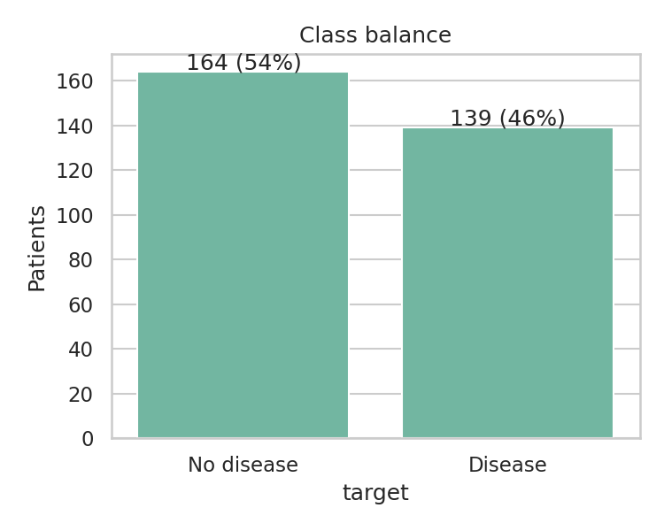
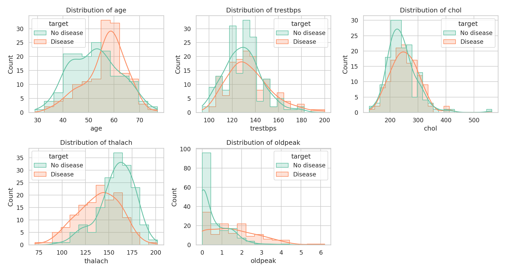
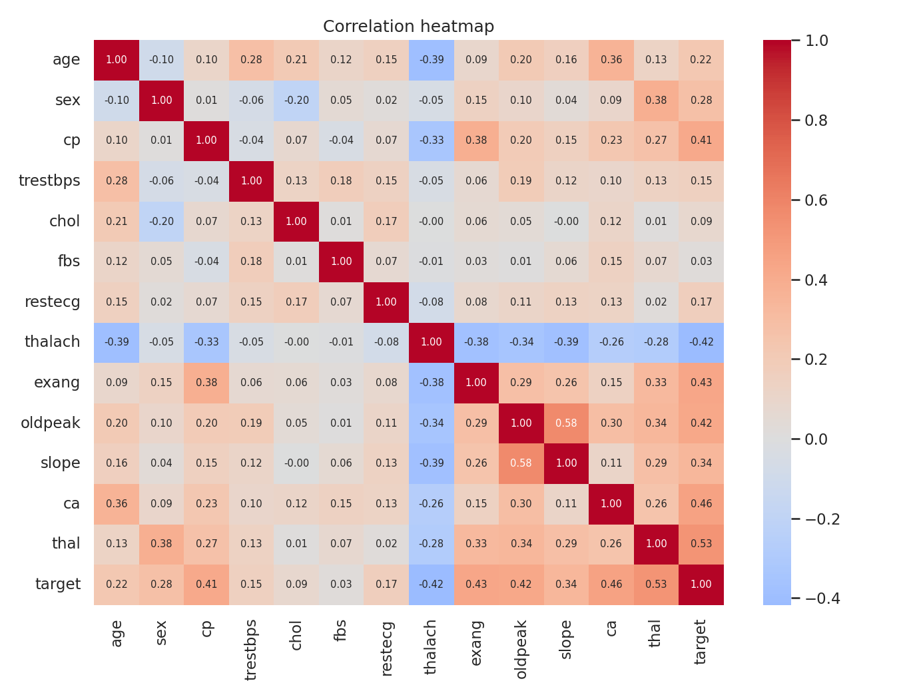
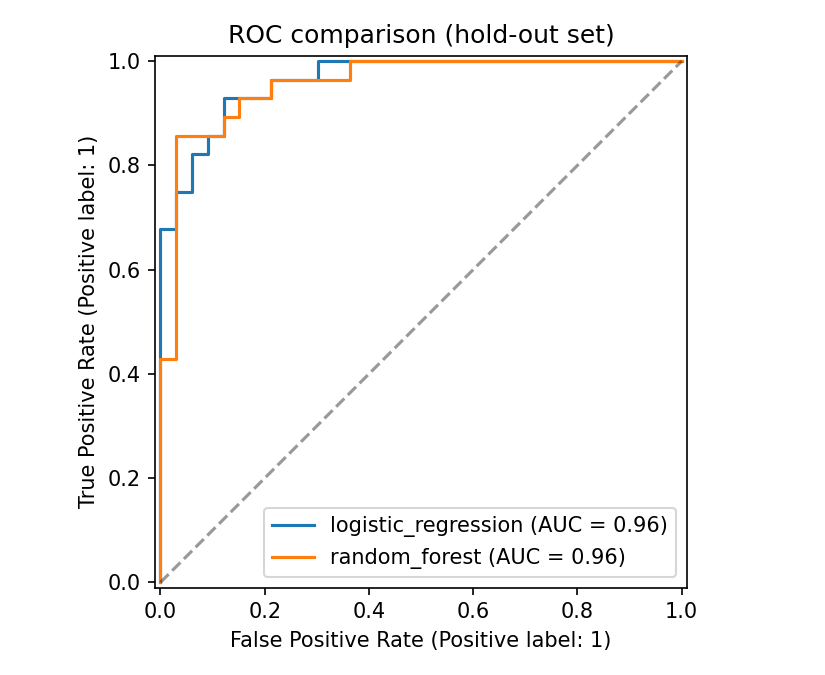

# Heart Disease Risk Prediction - End-to-End MLOps Report

**Course:** MLOps (AIMLCZG523) - Assignment 01  
**Name / ID:** `<<your name>>` / `<<your BITS ID>>`  
**Code repository:** `<<https://github.com/<user>/heart-risk-mlops>>`  
**Deployed API / access instructions:** `<<http://localhost/predict (Docker Desktop LoadBalancer) or public URL>>`  
**Demo video:** `<<link>>`

> HOW TO USE THIS TEMPLATE: everything in `<<...>>` must be replaced with your own numbers,
> observations and screenshots after you run the project. Rewrite sentences in your own words
> where your experience differed - the report should reflect what *you* did and learned.

---

## 1. Introduction
The goal is to predict whether a patient has heart disease from routine clinical measurements,
and to deliver the model as a reproducible, tested, containerised and monitored API. The
project follows the MLOps lifecycle: data -> experiments -> packaging -> CI/CD -> deployment ->
monitoring. Architecture is shown in Section 8.

## 2. Setup and installation
1. Python 3.11, then `python -m venv .venv` and `pip install -r requirements.txt`.
2. `python -m src.download` (downloads the UCI Cleveland file and writes `data/processed/heart_clean.csv`).
3. `python -m src.eda`, `python -m src.train`, `pytest -v`.
4. `uvicorn app.main:app --port 8000` or the Docker/Kubernetes steps in `README.md`.

`<<Mention OS, Python version, Docker/Minikube versions you used.>>`

## 3. Data and EDA
**Dataset.** UCI Heart Disease (Cleveland subset): `<<303>>` patients, 13 predictors, original
label `num` in 0-4. I converted it to binary (`num > 0` = disease present).

**Cleaning.** `?` marks were read as missing; `<<6>>` values were missing (`ca`: `<<4>>`,
`thal`: `<<2>>`); duplicates removed: `<<0>>`. Missing values are *not* filled in the cleaning
step; they are imputed inside the model pipeline (median for numeric, most-frequent for
categorical) so that no information from validation folds leaks into training.

**Class balance.** `<<54% no disease / 46% disease>>` - close to balanced, so accuracy is
meaningful, but I report precision, recall and ROC-AUC too. Recall matters most clinically
(a missed patient is costlier than a false alarm).

**Distributions.** `<<describe histograms: e.g. thalach is lower and oldpeak higher in the disease group>>`

**Correlations.** `<<which features correlate most with the target, e.g. ca, thal, oldpeak, cp, thalach; any collinearity>>`

**Categorical features by target.** `<<observations from 05_categorical_counts_by_target.png>>`

## 4. Feature engineering and modelling
**Preprocessing pipeline** (`src/features.py`): raw columns -> two engineered features ->
impute -> scale numeric (StandardScaler) -> one-hot encode categorical -> classifier. Everything is one
scikit-learn `Pipeline`, so serving applies exactly the same transforms as training.

| Engineered feature | Definition | Rationale |
|---|---|---|
| `hr_ratio` | `thalach / (220 - age)` | Max heart rate relative to age-predicted maximum |
| `high_bp` | `trestbps >= 140` | Hypertension flag |

**Models and tuning.** 80/20 stratified split (seed 42). For each model a 5-fold stratified
grid search optimised ROC-AUC on the training set only.

| Model | Grid |
|---|---|
| Logistic Regression | `C` in {0.01, 0.1, 1, 10}; `class_weight` in {None, balanced} |
| Random Forest | `n_estimators` in {100, 300}; `max_depth` in {3, 5, None}; `min_samples_leaf` in {1, 3} |

**Results** (paste `reports/metrics_table.md`):

`<<metrics table>>`

**Model selection.** I selected `<<model>>` because it had the highest mean CV ROC-AUC
(`<<value>>`). `<<Explain trade-offs: interpretability of LR vs. accuracy of RF, variance across folds, recall.>>`

**Limitations.** The CV scores of the best model are slightly optimistic because the same folds
were used for tuning (nested CV would be stricter); the dataset is small (`<<303>>` rows), so
confidence intervals are wide; the model is not a medical device.

## 5. Experiment tracking (MLflow)
Each model is one MLflow run in experiment `heart-disease-risk` (SQLite backend
`mlflow.db`). Logged per run: best hyper-parameters, split sizes and seed, CV mean/std and
hold-out metrics (accuracy, precision, recall, F1, ROC-AUC), confusion-matrix and ROC plots, and the
fitted pipeline with signature and input example. The selected run is tagged
`selected_for_serving=true` and also stores `model.joblib` as an artifact.

`<<Summarise what the MLflow comparison showed, include 04_mlflow_runs.png and 05_mlflow_run_detail.png>>`

## 6. Model packaging and reproducibility
- Final model: `models/model.joblib` (full pipeline, so raw inputs are accepted) plus the MLflow-format model in the run artifacts.
- `requirements.txt` pins exact versions; `requirements-api.txt` is the slim runtime subset with identical versions (important because pickled sklearn models are version-sensitive).
- Fixed seeds, versioned cleaned dataset, and a download script make every step re-runnable from a clean checkout.

## 7. Testing and CI/CD
**Unit tests** (`tests/`, pytest): cleaning (target binarisation, `?` handling, duplicates),
feature engineering and pipeline robustness (missing and unseen categories), training function
output ranges, and API behaviour (health, valid/invalid input, optional fields, `/metrics`).
`<<n>>` tests, all passing.

**GitHub Actions** (`.github/workflows/ci.yml`): `lint (flake8) -> test (pytest, JUnit artifact)
-> train (uploads model, MLflow DB, plots) -> docker (build and live smoke test of /health and
/predict)`. Jobs depend on each other, so any lint, test, training or container error fails the
pipeline and the logs show where.

`<<insert 07_ci_overview.png, 08_ci_artifacts.png and, if done, 09_ci_failure.png>>`

## 8. Architecture and containerisation

The API (FastAPI) exposes `POST /predict` (JSON in; prediction, label, risk probability and
confidence out), `GET /health` and `GET /metrics`. Inputs are validated with Pydantic
(ranges and allowed categories); invalid requests return HTTP 422. `ca` and `thal` are optional
because they are the fields missing in the source data. The image is built on `python:3.11-slim`, runs as
a non-root user and includes a health check.

`<<insert 10_docker_build.png and 11_docker_predict.png>>`

## 9. Deployment (Kubernetes)
`k8s/deployment.yaml`: 2 replicas, resource requests/limits, readiness and liveness probes on
`/health`. `k8s/service.yaml`: `LoadBalancer` on port 80 -> 8000. Cluster used:
`<<Docker Desktop Kubernetes / Minikube vX>>`. Endpoint verified with curl.

`<<insert 12_k8s_resources.png and 13_k8s_predict.png>>`

## 10. Monitoring and logging
- **Logging:** every request logs method, path, status and latency; every prediction logs inputs, class and probability (`kubectl logs`).
- **Metrics:** Prometheus counters/histograms - `api_requests_total{method,endpoint,status}`, `api_request_latency_seconds`, `api_predictions_total{label}`.
- **Dashboard:** Grafana "Heart Risk API" - request rate, p95 latency, predictions by outcome, error rate.

`<<insert 14_api_logs.png, 15_prometheus_targets.png, 16_grafana_dashboard.png and one sentence describing what you saw under load>>`

## 11. Challenges and lessons learned
`<<2-4 real problems you hit (e.g. image not found in Minikube, sklearn version mismatch, LoadBalancer pending) and how you fixed them.>>`

## 12. Future work
Data/prediction drift monitoring, MLflow Model Registry with staged promotion, automated retraining
trigger, Helm chart and HPA autoscaling, authentication and rate limiting on the API.

## 13. Repository and deliverables checklist
Code, Dockerfile, requirements, cleaned dataset + download script, EDA/training/inference scripts,
`tests/`, GitHub Actions workflow, Kubernetes manifests, screenshots folder, this report, API access
instructions, demo video. Link: `<<repo URL>>`.
